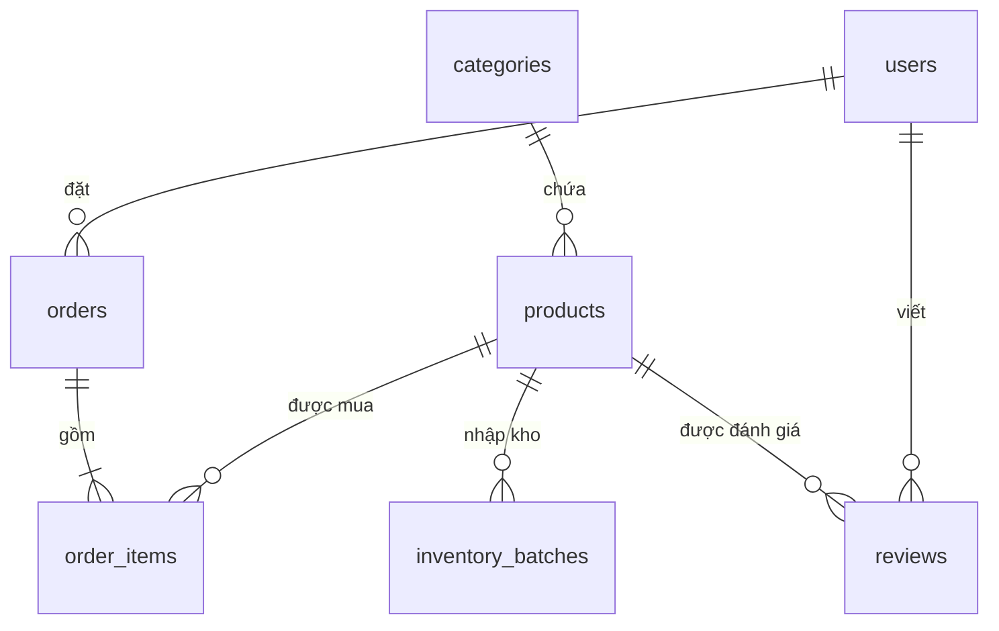

# 📦 Database Schema — Book & Hobby Retailer

> Tài liệu định nghĩa cấu trúc cơ sở dữ liệu của dự án.
> - **Sprint 1 & 2 (chốt):** `users`, `categories`, `products` — đầy đủ cột, ràng buộc, index, DDL.
> - **Sprint sau (dự kiến — DRAFT):** `inventory_batches`, `orders`, `order_items`, `reviews` — có trong sơ đồ quan hệ nên được phác thảo sẵn để các bảng hiện tại thiết kế khớp (khóa ngoại, snapshot giá...). Sẽ chốt chi tiết khi tới Sprint tương ứng.
> - Áp dụng **Soft Delete** thống nhất cho các bảng lõi (`users`, `categories`, `products`) và dùng **cột JSON** để giải quyết bài toán đa hình (Book / Hobby).
>
> **Đồng bộ với:** `sprint1-auth.md`, `sprint2-catalog.md`. Migration bằng **Flyway**.

---

## 🧭 Quy ước chung

| Hạng mục | Quy ước |
|---|---|
| Engine / Charset | `InnoDB`, `utf8mb4`, collation `utf8mb4_unicode_ci` (so khớp không phân biệt hoa thường và dấu → tìm "nguyen" ra "Nguyễn") |
| Khóa chính | `BIGINT UNSIGNED AUTO_INCREMENT`, tên cột `id` |
| Đặt tên | `snake_case`, bảng số nhiều, khóa ngoại `<bảng_đơn>_id`, index `idx_<bảng>_<cột>`, unique `uk_<bảng>_<cột>`, khóa ngoại `fk_<bảng>_<bảng_cha>` |
| Thời gian | `DATETIME`, **luôn lưu UTC** ở DB và Backend (`hibernate.jdbc.time_zone=UTC`, JVM timezone UTC, JDBC URL đặt múi giờ kết nối là UTC để `CURRENT_TIMESTAMP` cũng là UTC; ưu tiên JPA Auditing điền `created_at`/`updated_at`). API trả ISO-8601 có hậu tố `Z`; Frontend hiển thị giờ Việt Nam (`+07:00`) theo múi giờ trình duyệt. Nghiệp vụ theo "ngày" (báo cáo, cắt đơn) phải chỉ định rõ `Asia/Ho_Chi_Minh` khi tính |
| Tiền tệ | **VND, số nguyên**: `DECIMAL(15,0)`, không dùng `FLOAT`/`DOUBLE`. Java dùng `BigDecimal`. API trả `79000` (không có `.00`). Khi tích hợp VNPAY/MoMo, việc nhân 100 chỉ làm ở tầng tích hợp. Khi có giảm giá %, làm tròn `HALF_UP` về số nguyên trên từng dòng |
| Soft Delete | Bảng lõi có `deleted_at DATETIME NULL`. Mọi truy vấn mặc định lọc `deleted_at IS NULL` (`@SQLRestriction`). **Không bao giờ dùng `DELETE`** trên bảng lõi |
| Khóa UNIQUE + Soft Delete | `users`: khi xóa mềm, `email` đổi thành `<email>#deleted_<id>`, `phone_number` đặt `NULL`. `categories`: `name` đổi thành `<name>#deleted_<id>`. `products`: **giữ nguyên** `sku` (đơn hàng cũ tham chiếu đúng mã) |
| Khóa ngoại | `ON DELETE RESTRICT` (vì dùng soft delete nên không xóa cứng bản ghi cha) |
| Migration | `V1__init_users.sql`, `V2__catalog.sql`, `V3__seed_catalog_dev.sql` (chỉ profile `dev`), các bảng draft sang `V4+` |

---

## 🏷️ Danh sách Enum

### `Role` — Vai trò người dùng
| Giá trị | Ý nghĩa |
|---|---|
| `ROLE_CUSTOMER` | Khách hàng mua sắm |
| `ROLE_ADMIN` | Quản trị viên hệ thống (đăng sản phẩm, duyệt đơn) |

> Hệ thống chỉ có đúng 2 role này. Admin đầu tiên được **seed** khi khởi động (UC00), không tạo được qua API.

---

### `AccountStatus` — Trạng thái tài khoản
| Giá trị | Ý nghĩa |
|---|---|
| `ACTIVE` | Tài khoản hoạt động bình thường *(mặc định)* |
| `LOCKED` | Bị Admin khóa, không thể đăng nhập / dùng token |

---

### `AuthProvider` — Nền tảng xác thực
| Giá trị | Ý nghĩa |
|---|---|
| `LOCAL` | Đăng ký bằng email/password truyền thống *(mặc định)* |
| `GOOGLE` | Đăng nhập qua Google OAuth2 (`password = NULL`) |

---

### `ProductType` — Phân loại sản phẩm đa hình
| Giá trị | Ý nghĩa |
|---|---|
| `BOOK` | Sách (Schema `attributes`: tác giả, NXB, số trang, ISBN) |
| `HOBBY` | Mô hình, đồ chơi, boardgame (Schema `attributes`: hãng sx, tỷ lệ, chất liệu) |

---

### `ProductStatus` — Trạng thái hiển thị sản phẩm *(mới)*
| Giá trị | Ý nghĩa |
|---|---|
| `ACTIVE` | Đang bán, khách thấy *(mặc định)* |
| `HIDDEN` | Ẩn tạm thời — khách không thấy (API public trả `404`), Admin vẫn thấy và sửa được |

---

### Enum dự kiến cho Sprint sau *(DRAFT)*
| Enum | Giá trị |
|---|---|
| `OrderStatus` | `PENDING` (chờ xử lý/đang giữ hàng) → `CONFIRMED` (Admin xác nhận) → `SHIPPING` → `COMPLETED`; nhánh `CANCELLED` |
| `PaymentMethod` | `COD`, `ONLINE` |
| `PaymentStatus` | `UNPAID`, `PAID`, `REFUNDED` |

---

## 🗄️ Sơ đồ quan hệ tóm tắt

```text
users ──1:N──> orders
users ──1:N──> reviews

categories ──1:N──> products

products ──1:N──> inventory_batches
products ──1:N──> order_items
products ──1:N──> reviews

orders ──1:N──> order_items
```



> Các bảng **Sprint 1 & 2:** `users`, `categories`, `products`. Các bảng còn lại là **DRAFT**.

---

# ✅ PHẦN A — SPRINT 1 & 2 (đã chốt)

## 1. Bảng `users`

Lưu tài khoản Customer và Admin.

| Cột | Kiểu | Ràng buộc | Mô tả |
|---|---|---|---|
| `id` | `BIGINT UNSIGNED` | PK, AUTO_INCREMENT | |
| `email` | `VARCHAR(255)` | NOT NULL, UNIQUE | Đã chuẩn hoá `trim + lowercase` |
| `password` | `VARCHAR(100)` | NULL | Hash BCrypt (60 ký tự). `NULL` nếu `auth_provider = GOOGLE` |
| `full_name` | `VARCHAR(100)` | NOT NULL | 2–100 ký tự |
| `phone_number` | `VARCHAR(15)` | NULL, UNIQUE | Dạng `0xxxxxxxxx`. Nullable vì tài khoản Google không có SĐT (MySQL cho phép nhiều `NULL` trong UNIQUE) |
| `avatar_key` | `VARCHAR(50)` | NOT NULL, default `'default'` | Key avatar có sẵn (không lưu URL tự do) |
| `role` | `ENUM('ROLE_CUSTOMER','ROLE_ADMIN')` | NOT NULL, default `ROLE_CUSTOMER` | |
| `account_status` | `ENUM('ACTIVE','LOCKED')` | NOT NULL, default `ACTIVE` | |
| `auth_provider` | `ENUM('LOCAL','GOOGLE')` | NOT NULL, default `LOCAL` | |
| `reset_token` | `CHAR(64)` | NULL | **SHA-256 hash** (hex) của UUID token; không lưu token thô |
| `reset_token_exp` | `DATETIME` | NULL | Hết hạn sau 15 phút; reset xong đặt `NULL` |
| `password_changed_at` | `DATETIME` | NULL | JWT có `iat` nhỏ hơn mốc này bị từ chối |
| `created_at` | `DATETIME` | NOT NULL | |
| `updated_at` | `DATETIME` | NOT NULL | |
| `deleted_at` | `DATETIME` | NULL | Soft delete |

**Index:**

| Tên | Cột | Mục đích |
|---|---|---|
| `uk_users_email` | `email` | UNIQUE |
| `uk_users_phone_number` | `phone_number` | UNIQUE |
| `idx_users_reset_token` | `reset_token` | Tra token khi reset mật khẩu |
| `idx_users_role` | `role` | Kiểm tra tồn tại Admin khi seed (UC00) |

**Ràng buộc nghiệp vụ (kiểm tra ở tầng Service):**
- `auth_provider = LOCAL` ⇒ `password` phải có giá trị; `GOOGLE` ⇒ `password = NULL`.
- Response không bao giờ trả `password`, `reset_token`, `reset_token_exp`, `deleted_at`, `password_changed_at`.
- Chỉ có cách tạo `ROLE_ADMIN` là seed lúc khởi động.

```sql
CREATE TABLE users (
  id                  BIGINT UNSIGNED NOT NULL AUTO_INCREMENT,
  email               VARCHAR(255)  NOT NULL,
  password            VARCHAR(100)  NULL,
  full_name           VARCHAR(100)  NOT NULL,
  phone_number        VARCHAR(15)   NULL,
  avatar_key          VARCHAR(50)   NOT NULL DEFAULT 'default',
  role                ENUM('ROLE_CUSTOMER','ROLE_ADMIN') NOT NULL DEFAULT 'ROLE_CUSTOMER',
  account_status      ENUM('ACTIVE','LOCKED')            NOT NULL DEFAULT 'ACTIVE',
  auth_provider       ENUM('LOCAL','GOOGLE')             NOT NULL DEFAULT 'LOCAL',
  reset_token         CHAR(64)      NULL,
  reset_token_exp     DATETIME      NULL,
  password_changed_at DATETIME      NULL,
  created_at          DATETIME      NOT NULL,
  updated_at          DATETIME      NOT NULL,
  deleted_at          DATETIME      NULL,
  PRIMARY KEY (id),
  CONSTRAINT uk_users_email        UNIQUE (email),
  CONSTRAINT uk_users_phone_number UNIQUE (phone_number),
  INDEX idx_users_reset_token (reset_token),
  INDEX idx_users_role (role)
) ENGINE=InnoDB DEFAULT CHARSET=utf8mb4 COLLATE=utf8mb4_unicode_ci;
```

---

## 2. Bảng `categories`

Danh mục **phẳng** (không lồng nhau ở Sprint 2). Ví dụ: Literature, Boardgames, Figures.

| Cột | Kiểu | Ràng buộc | Mô tả |
|---|---|---|---|
| `id` | `BIGINT UNSIGNED` | PK, AUTO_INCREMENT | |
| `name` | `VARCHAR(160)` | NOT NULL, UNIQUE | Tên hiển thị 2–100 ký tự. Cột rộng 160 để chứa hậu tố `#deleted_<id>` |
| `description` | `VARCHAR(500)` | NULL | |
| `created_at` | `DATETIME` | NOT NULL | |
| `updated_at` | `DATETIME` | NOT NULL | |
| `deleted_at` | `DATETIME` | NULL | Soft delete |

**Index:** `uk_categories_name` (`name`, UNIQUE).

**Ràng buộc nghiệp vụ:**
- Không xóa được danh mục còn sản phẩm chưa xóa (**gồm cả `HIDDEN`**) → `400`.
- Khi xóa mềm: `deleted_at = now()`, `name = '<name>#deleted_<id>'`.

```sql
CREATE TABLE categories (
  id          BIGINT UNSIGNED NOT NULL AUTO_INCREMENT,
  name        VARCHAR(160) NOT NULL,
  description VARCHAR(500) NULL,
  created_at  DATETIME NOT NULL,
  updated_at  DATETIME NOT NULL,
  deleted_at  DATETIME NULL,
  PRIMARY KEY (id),
  CONSTRAINT uk_categories_name UNIQUE (name)
) ENGINE=InnoDB DEFAULT CHARSET=utf8mb4 COLLATE=utf8mb4_unicode_ci;
```

---

## 3. Bảng `products`

Một bảng duy nhất cho cả **Book** và **Hobby**; thuộc tính riêng lưu ở cột JSON `attributes` (không dùng EAV, không dư thừa cột).

| Cột | Kiểu | Ràng buộc | Mô tả |
|---|---|---|---|
| `id` | `BIGINT UNSIGNED` | PK, AUTO_INCREMENT | |
| `sku` | `VARCHAR(30)` | NOT NULL, UNIQUE | Chữ hoa/số/`-`, 3–30 ký tự. **Không đổi** sau khi tạo; **vẫn giữ chỗ** sau khi xóa mềm |
| `name` | `VARCHAR(255)` | NOT NULL | 2–255 ký tự |
| `description` | `TEXT` | NULL | Tối đa 5000 ký tự (kiểm tra ở Service) |
| `base_price` | `DECIMAL(15,0)` | NOT NULL, CHECK `> 0` | Giá bán gốc (VND, số nguyên), tối đa 1 tỷ |
| `category_id` | `BIGINT UNSIGNED` | NOT NULL, FK → `categories.id` | |
| `product_type` | `ENUM('BOOK','HOBBY')` | NOT NULL | **Không đổi** sau khi tạo |
| `status` | `ENUM('ACTIVE','HIDDEN')` | NOT NULL, default `ACTIVE` | |
| `thumbnail_url` | `VARCHAR(500)` | NULL | URL ảnh do Admin nhập (http/https) |
| `attributes` | `JSON` | NOT NULL, CHECK là object | Thuộc tính theo `product_type` (xem bên dưới) |
| `stock_quantity` | `INT` | NOT NULL, default `0`, CHECK `>= 0` | Tồn kho thực tế. Sprint 2 luôn `0`; sau này đồng bộ từ `inventory_batches` |
| `reserved_quantity` | `INT` | NOT NULL, default `0` | Số lượng đang **giữ hàng** cho các đơn `PENDING`. Ràng buộc `0 <= reserved_quantity <= stock_quantity`. Sprint 2 luôn `0` |
| `version` | `BIGINT` | NOT NULL, default `0` | Optimistic locking (`@Version`) |
| `created_at` | `DATETIME` | NOT NULL | |
| `updated_at` | `DATETIME` | NOT NULL | |
| `deleted_at` | `DATETIME` | NULL | Soft delete |

**Index:**

| Tên | Cột | Mục đích |
|---|---|---|
| `uk_products_sku` | `sku` | UNIQUE |
| `idx_products_list` | `deleted_at, status, category_id` | Danh sách public lọc theo danh mục |
| `idx_products_price` | `deleted_at, base_price` | Lọc/sắp xếp theo giá |
| `idx_products_created` | `created_at` | Sắp xếp mới nhất |
| `fk_products_category` | `category_id` | Khóa ngoại (`ON DELETE RESTRICT`) |

**Cấu trúc JSON `attributes`:**

`product_type = BOOK`:

```json
{
  "author":    "Paulo Coelho",
  "publisher": "NXB Văn Học",
  "pages":     228,
  "isbn":      "9786045888292"
}
```

`product_type = HOBBY`:

```json
{
  "brand":    "Good Smile Company",
  "scale":    "1/7",
  "material": "PVC"
}
```

| Loại | Key | Kiểu | Quy tắc |
|---|---|---|---|
| BOOK | `author` | string | 1–255 ký tự |
| BOOK | `publisher` | string | 1–255 ký tự |
| BOOK | `pages` | integer | 1–10000 |
| BOOK | `isbn` | string | ISBN-10/13 đúng checksum, lưu dạng đã bỏ `-` và khoảng trắng |
| HOBBY | `brand` | string | 1–100 ký tự |
| HOBBY | `scale` | string | `1/7`, `1/72`... hoặc `N/A` (vd: boardgame) |
| HOBBY | `material` | string | 1–100 ký tự |

> Chỉ chấp nhận đúng các key ở bảng trên (key lạ → `400`). Việc validate kiểu và giá trị thực hiện ở tầng Service (`BookAttributesValidator`, `HobbyAttributesValidator`); DB chỉ bảo đảm `attributes` là JSON object hợp lệ.

**Ràng buộc nghiệp vụ:**
- `stock_quantity` và `reserved_quantity` không sửa qua API sản phẩm; chỉ hệ thống tồn kho/đơn hàng cập nhật (Sprint sau).
- **Tồn khả dụng = `stock_quantity - reserved_quantity`.** `inStock` ở API public tính theo `stock_quantity - reserved_quantity > 0`.
- Các cột tồn kho chỉ được cập nhật bằng câu `UPDATE` nguyên tử riêng (không qua `save()` của JPA) và **không tăng `version`**, để Admin đang sửa sản phẩm không bị `409` mỗi khi có người đặt hàng (xem mục *Luồng giữ hàng*).
- Public chỉ thấy sản phẩm `deleted_at IS NULL` **và** `status = ACTIVE`, và không thấy `sku`, `stock_quantity`, `reserved_quantity`, `status`, `version`.
- Kiểm tra trùng `sku` phải dùng **native query không lọc `deleted_at`**.

```sql
CREATE TABLE products (
  id             BIGINT UNSIGNED NOT NULL AUTO_INCREMENT,
  sku            VARCHAR(30)   NOT NULL,
  name           VARCHAR(255)  NOT NULL,
  description    TEXT          NULL,
  base_price     DECIMAL(15,0) NOT NULL,
  category_id    BIGINT UNSIGNED NOT NULL,
  product_type   ENUM('BOOK','HOBBY')      NOT NULL,
  status         ENUM('ACTIVE','HIDDEN')   NOT NULL DEFAULT 'ACTIVE',
  thumbnail_url  VARCHAR(500)  NULL,
  attributes     JSON          NOT NULL,
  stock_quantity INT           NOT NULL DEFAULT 0,
  reserved_quantity INT        NOT NULL DEFAULT 0,
  version        BIGINT        NOT NULL DEFAULT 0,
  created_at     DATETIME      NOT NULL,
  updated_at     DATETIME      NOT NULL,
  deleted_at     DATETIME      NULL,
  PRIMARY KEY (id),
  CONSTRAINT uk_products_sku UNIQUE (sku),
  CONSTRAINT fk_products_category FOREIGN KEY (category_id)
    REFERENCES categories (id) ON DELETE RESTRICT,
  CONSTRAINT chk_products_price CHECK (base_price > 0),
  CONSTRAINT chk_products_stock CHECK (stock_quantity >= 0),
  CONSTRAINT chk_products_reserved CHECK (reserved_quantity >= 0 AND reserved_quantity <= stock_quantity),
  CONSTRAINT chk_products_attributes CHECK (JSON_TYPE(attributes) = 'OBJECT'),
  INDEX idx_products_list    (deleted_at, status, category_id),
  INDEX idx_products_price   (deleted_at, base_price),
  INDEX idx_products_created (created_at)
) ENGINE=InnoDB DEFAULT CHARSET=utf8mb4 COLLATE=utf8mb4_unicode_ci;
```

---

## 4. Danh sách avatar có sẵn (không phải bảng)

Không lưu trong DB — là cấu hình cố định phía backend (enum hoặc file cấu hình). `users.avatar_key` chỉ tham chiếu tới `key` trong danh sách này.

| `key` | `url` (ví dụ) |
|---|---|
| `default` | `/static/avatars/default.png` |
| `avatar_01` … `avatar_N` | `/static/avatars/avatar_01.png` … |

> Không có ràng buộc khóa ngoại ở DB; Service kiểm tra `avatarKey` hợp lệ (sai → `400`). Danh sách cụ thể sẽ chốt sau.

---

# 🚧 PHẦN B — CÁC BẢNG SPRINT SAU (DRAFT)

> Chỉ phác thảo để bảo đảm thiết kế Sprint 1–2 khớp về sau. Các quyết định kiến trúc đã chốt: **giữ hàng bằng cột `reserved_quantity`**, **giỏ hàng chỉ ở LocalStorage (không có bảng `carts`)**, **địa chỉ giao hàng lưu snapshot trong `orders` (không có bảng `addresses`)**, tiền VND số nguyên. Chi tiết từng bảng sẽ chốt khi tới Sprint tương ứng.

## 🔄 Luồng giữ hàng (Checkout Flow)

Giỏ hàng nằm ở LocalStorage của Frontend; khi thanh toán, Frontend gửi mảng `items` (chỉ gồm `productId`, `quantity`) xuống Backend. **Giá, tên, sku luôn lấy từ DB** rồi lưu snapshot vào `order_items` — không tin giá từ client.

| Sự kiện | `stock_quantity` | `reserved_quantity` |
|---|---|---|
| Đặt đơn (`PENDING`) | không đổi | `+ quantity` |
| Đơn bị hủy / hết hạn (`CANCELLED`) | không đổi | `- quantity` |
| Đơn hoàn tất (`COMPLETED`) | `- quantity` | `- quantity` |

**Quy tắc kỹ thuật:**
- Giữ hàng bằng một câu UPDATE nguyên tử, kiểm tra số dòng bị ảnh hưởng (0 dòng = hết hàng → từ chối đơn):
  `UPDATE products SET reserved_quantity = reserved_quantity + :q WHERE id = :id AND deleted_at IS NULL AND status = 'ACTIVE' AND stock_quantity - reserved_quantity >= :q`
- Đơn nhiều sản phẩm xử lý theo thứ tự `product_id` tăng dần (tránh deadlock) và nằm trong một transaction.
- Job `@Scheduled` tự hủy đơn `PENDING` quá hạn (`orders.expires_at`) và trả lại `reserved_quantity`.
- Chống tạo đơn trùng (bấm đúp / mạng chậm) bằng `Idempotency-Key` do Frontend sinh, lưu ở `orders.idempotency_key`.
- Khi trừ `stock_quantity`, đồng thời trừ `quantity_remaining` của các lô (`inventory_batches`) theo FIFO.

## 5. Bảng `inventory_batches` *(DRAFT)*

Quản lý tồn kho theo **lô nhập**. `products.stock_quantity` là tổng `quantity_remaining` của các lô.

| Cột | Kiểu | Ràng buộc | Mô tả |
|---|---|---|---|
| `id` | `BIGINT UNSIGNED` | PK | |
| `product_id` | `BIGINT UNSIGNED` | NOT NULL, FK → `products.id` | |
| `batch_code` | `VARCHAR(50)` | NULL | Mã lô / số phiếu nhập |
| `quantity_in` | `INT` | NOT NULL, CHECK `> 0` | Số lượng nhập ban đầu |
| `quantity_remaining` | `INT` | NOT NULL, CHECK `>= 0` | Còn lại của lô |
| `import_price` | `DECIMAL(15,0)` | NOT NULL, CHECK `>= 0` | Giá vốn của lô (VND, số nguyên) |
| `imported_at` | `DATETIME` | NOT NULL | Ngày nhập |
| `created_by` | `BIGINT UNSIGNED` | NOT NULL, FK → `users.id` | Admin nhập kho |
| `created_at` | `DATETIME` | NOT NULL | |

Index: `(product_id, imported_at)` — phục vụ xuất kho theo FIFO.

---

## 6. Bảng `orders` *(DRAFT)*

| Cột | Kiểu | Ràng buộc | Mô tả |
|---|---|---|---|
| `id` | `BIGINT UNSIGNED` | PK | |
| `order_code` | `VARCHAR(20)` | NOT NULL, UNIQUE | Mã đơn hiển thị cho khách |
| `user_id` | `BIGINT UNSIGNED` | NOT NULL, FK → `users.id` | |
| `status` | `ENUM('PENDING','CONFIRMED','SHIPPING','COMPLETED','CANCELLED')` | NOT NULL, default `PENDING` | |
| `payment_method` | `ENUM('COD','ONLINE')` | NOT NULL | |
| `payment_status` | `ENUM('UNPAID','PAID','REFUNDED')` | NOT NULL, default `UNPAID` | |
| `total_amount` | `DECIMAL(15,0)` | NOT NULL, CHECK `>= 0` | Tổng tiền tại thời điểm đặt (VND, số nguyên) |
| `shipping_name` | `VARCHAR(100)` | NOT NULL | Snapshot người nhận |
| `shipping_phone` | `VARCHAR(15)` | NOT NULL | Snapshot SĐT nhận hàng |
| `shipping_address` | `VARCHAR(500)` | NOT NULL | Snapshot địa chỉ |
| `note` | `VARCHAR(500)` | NULL | |
| `expires_at` | `DATETIME` | NULL | Hạn giữ hàng của đơn `PENDING`; quá hạn job tự hủy và trả `reserved_quantity` |
| `idempotency_key` | `VARCHAR(64)` | NULL | Khóa chống tạo đơn trùng do Frontend sinh; UNIQUE `(user_id, idempotency_key)` |
| `created_at` / `updated_at` | `DATETIME` | NOT NULL | |

> Không có `deleted_at` (đơn hàng không xóa, chỉ chuyển `CANCELLED`). Địa chỉ giao hàng nhập trực tiếp khi đặt và lưu **snapshot** trong đơn (không có bảng `addresses`) để sửa hồ sơ user sau này không làm đổi đơn cũ. Frontend có thể điền sẵn từ đơn gần nhất của khách.

---

## 7. Bảng `order_items` *(DRAFT)*

| Cột | Kiểu | Ràng buộc | Mô tả |
|---|---|---|---|
| `id` | `BIGINT UNSIGNED` | PK | |
| `order_id` | `BIGINT UNSIGNED` | NOT NULL, FK → `orders.id` | |
| `product_id` | `BIGINT UNSIGNED` | NOT NULL, FK → `products.id` | Vẫn hợp lệ khi sản phẩm bị xóa mềm |
| `sku` | `VARCHAR(30)` | NOT NULL | **Snapshot** tại thời điểm đặt |
| `product_name` | `VARCHAR(255)` | NOT NULL | **Snapshot** |
| `unit_price` | `DECIMAL(15,0)` | NOT NULL, CHECK `>= 0` | **Snapshot** giá (VND, số nguyên) — đổi `base_price` sau đó không ảnh hưởng đơn cũ |
| `quantity` | `INT` | NOT NULL, CHECK `> 0` | |
| `line_total` | `DECIMAL(15,0)` | NOT NULL | `unit_price × quantity` |

Unique: `(order_id, product_id)`.

---

## 8. Bảng `reviews` *(DRAFT)*

| Cột | Kiểu | Ràng buộc | Mô tả |
|---|---|---|---|
| `id` | `BIGINT UNSIGNED` | PK | |
| `user_id` | `BIGINT UNSIGNED` | NOT NULL, FK → `users.id` | |
| `product_id` | `BIGINT UNSIGNED` | NOT NULL, FK → `products.id` | |
| `rating` | `TINYINT` | NOT NULL, CHECK `BETWEEN 1 AND 5` | |
| `comment` | `VARCHAR(2000)` | NULL | |
| `created_at` / `updated_at` | `DATETIME` | NOT NULL | |

Unique: `(user_id, product_id)` — mỗi người đánh giá một sản phẩm một lần. Điều kiện chỉ người đã mua (đơn `COMPLETED`) mới được đánh giá kiểm tra ở Service.

---

## 🔗 Bảng tổng hợp khóa ngoại

| Bảng con | Cột | Bảng cha | Trạng thái |
|---|---|---|---|
| `products` | `category_id` | `categories.id` | ✅ Sprint 2 |
| `inventory_batches` | `product_id`, `created_by` | `products.id`, `users.id` | 🚧 Draft |
| `orders` | `user_id` | `users.id` | 🚧 Draft |
| `order_items` | `order_id`, `product_id` | `orders.id`, `products.id` | 🚧 Draft |
| `reviews` | `user_id`, `product_id` | `users.id`, `products.id` | 🚧 Draft |

---

## 📌 Thay đổi so với bản `data-schema.md` trước

| # | Thay đổi | Lý do |
|---|---|---|
| 1 | Thêm bảng chi tiết `users`, `categories`, `products` (cột, kiểu, ràng buộc, index, DDL) | Bản cũ chỉ có enum và sơ đồ |
| 2 | `users`: thêm `avatar_key` (thay `avatar_url`), `reset_token` (CHAR(64), lưu hash), `reset_token_exp`, `password_changed_at` | UC03, UC06, avatar có sẵn, vô hiệu JWT cũ |
| 3 | `users.phone_number`: UNIQUE và **nullable** | UC01/UC05; tài khoản Google không có SĐT |
| 4 | `users`: không có `wallet_balance` | Mô hình B2C không có ví |
| 5 | `products`: thêm `status`, `version`, `description`, `thumbnail_url` | Ẩn/hiện, optimistic locking, đủ dữ liệu hiển thị |
| 6 | Thêm enum `ProductStatus` | Hỗ trợ `status` |
| 7 | Quy tắc giải phóng khóa UNIQUE khi soft delete (`users`, `categories`); `products.sku` giữ chỗ | Đăng ký/tạo lại không bị `409` oan; đơn cũ luôn tham chiếu đúng mã |
| 8 | Phác thảo `inventory_batches`, `orders`, `order_items`, `reviews` | Có trong sơ đồ quan hệ; chốt `order_items` phải lưu snapshot giá |
| 9 | Chốt lưu thời gian theo **UTC** | Tránh lệch ngày khi deploy Cloud ở quốc gia khác |
| 10 | `products`: thêm `reserved_quantity` (+ CHECK); `orders`: thêm `expires_at`, `idempotency_key` | Giữ hàng tạm thời, tự hủy đơn quá hạn, chống tạo đơn trùng |
| 11 | Tiền đổi từ `DECIMAL(12,2)` sang `DECIMAL(15,0)` (VND số nguyên) | VND không có phần lẻ; tránh lỗi làm tròn, dễ tích hợp VNPAY/MoMo |
| 12 | Chốt **không** tạo bảng `carts`/`cart_items`, `addresses`, `inventory_reservations` | Giỏ ở LocalStorage; địa chỉ lưu snapshot trong `orders`; giữ hàng bằng `reserved_quantity` |

---

## ✅ Quyết định đã chốt

| Chủ đề | Quyết định |
|---|---|
| Múi giờ | Lưu UTC ở DB + Backend; Frontend hiển thị `+07:00` |
| Giữ hàng | Cột `reserved_quantity` trong `products`; không có bảng `inventory_reservations` |
| Giỏ hàng | LocalStorage ở Frontend; không có bảng `carts`; Backend tự lấy giá từ DB |
| Địa chỉ giao hàng | Nhập trực tiếp, lưu snapshot trong `orders`; không có bảng `addresses` |
| Tiền tệ | VND số nguyên `DECIMAL(15,0)` |
| Tìm kiếm | Giữ index cơ bản; chưa làm FULLTEXT / generated column cho JSON cho đến khi vượt ~100.000 bản ghi hoặc `EXPLAIN` cho thấy chậm |

## ❓ Điểm còn mở

1. **Mốc trừ `stock_quantity`:** hiện chốt trừ khi đơn `COMPLETED`. Có thể chọn trừ khi `SHIPPING` (hàng thực tế đã rời kho, khớp kiểm kê hơn) — cần quyết định trước khi làm Sprint đơn hàng.
2. **Hạn giữ hàng (`expires_at`):** ví dụ đơn thanh toán online 15–30 phút; đơn COD chờ Admin xác nhận tối đa 24 giờ.
3. **Đơn đã giao bị hoàn:** xử lý tồn kho và `payment_status` (`REFUNDED`) ra sao.

---

## 🛠 Ghi chú triển khai (Migration Notes)

**Câu lệnh Native SQL Update Tồn Kho:**
Để tránh Deadlock và Overselling, hệ thống bắt buộc phải cập nhật `reserved_quantity` bằng Native Query thay vì dùng Entity `save()` của Hibernate:

```sql
-- Đặt hàng (Thêm vào reserved_quantity)
UPDATE products 
SET reserved_quantity = reserved_quantity + :qty 
WHERE id = :productId 
  AND (stock_quantity - reserved_quantity) >= :qty;

-- Hủy đơn (Trả lại reserved_quantity)
UPDATE products 
SET reserved_quantity = reserved_quantity - :qty 
WHERE id = :productId;
```
*(Nếu số dòng cập nhật trả về = 0 tức là đã hết hàng hoặc sai logic)*
